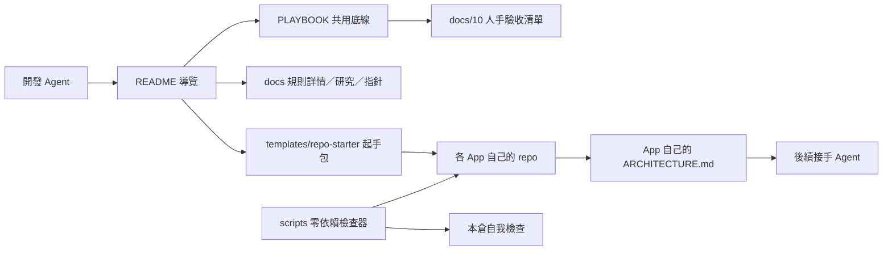

# readme 真理倉 — Architecture Map

> 本倉係所有 App 共用的研發規則、開局範本與驗收工具入口；唔係任何一個已部署 App。每個 App 的 as-designed／as-built 地圖留在該 App 自己的 repo。
> 最後核對：2026-11-19 · branch `arena/14eca349-readme`（工作中）

## 1. 本倉邊界

- **目的**：為未來及持續研發中的 App 提供共用最低要求、決策入口、起手包與檢查工具。
- **本倉負責**：通用 PLAYBOOK、文件索引、repo-starter、模板、靜態 guard／preflight／驗收腳本。
- **本倉不負責**：各 App 的專案專屬架構、SCOPE、as-built、資料或部署設定；以上資料由各 App 自己的 repo 維護。

## 2. 本倉地圖

## 3. 元件與資料責任

| 元件 | 責任 | Source of truth | 程式位置 |
|---|---|---|---|
| 根 README | 按任務導向文件／範本 | 本倉總入口 | `README.md` |
| PLAYBOOK | 所有 App 的共用最低要求與規則 ID | 通用規則唯一表 | `PLAYBOOK.md` |
| docs | 詳細規格、工具研究、通用做法 | 以各章標示的唯一來源為準 | `docs/` |
| repo-starter | 新 App 複製用的共通骨架與 Agent 指示 | 本倉模板 | `templates/repo-starter/` |
| scripts | 檔案／連結／設定等可機械化檢查 | scripts 本身及其規格文件 | `scripts/` |
| App-specific repo | 該 App 的設計圖、SCOPE、as-built、實作與驗收 | 該 App repo | 各自 repo；本倉不收其細節 |

## 4. 關鍵流程

1. **開新 App**：使用者確認需求 → Agent 先讀本倉 README／PLAYBOOK → 按 `INTAKE.md` 釐清範圍 → 在 App repo 寫 SCOPE 與 `ARCHITECTURE.md` 設計地圖 → 抄起手包／實作 → 跑 PREFLIGHT、guard、tests 與人手驗收。
2. **持續改 App**：接手 Agent 先讀 App repo 的 `AGENTS.md`、`README.md`、`SCOPE.md`、`ARCHITECTURE.md` → 對照 map 理解邊界 → 涉及架構變更先更新地圖 → 實作與驗收。
3. **更新通用規則**：改 PLAYBOOK → 詳情 docs／checklist／模板同步 → guard／consistency／tests 驗證 → 根 README 導覽更新。

## 5. 安全／邊界

- 本倉只訂通用規範、提供範本與檢查器；不代替用戶決定 App 專屬業務架構。
- App 的具體設計意圖與現況地圖必須留在各自 repo，方便下個 Agent 接續；不可只放在對話或本倉集中維護。
- 靜態檢查通過不等於 App 功能、架構或 runtime 已驗證；按 PLAYBOOK／docs/10 完成人手及適用的 runtime 驗收。
